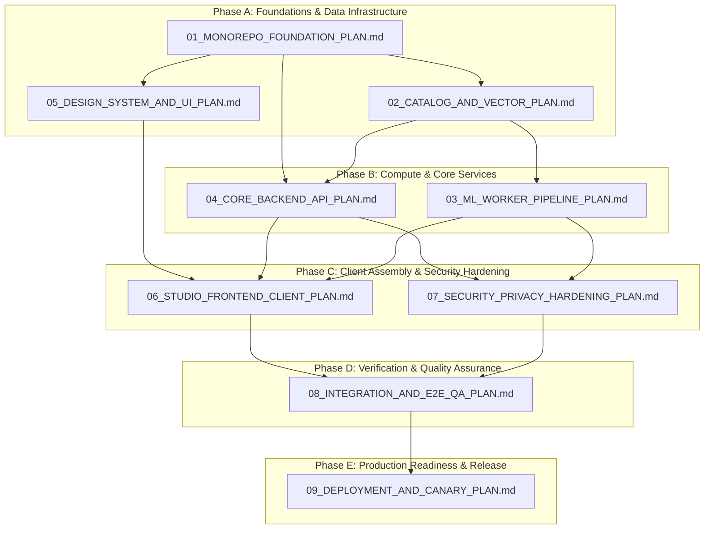

# Plan Document: 00_MASTER_EXECUTION_INDEX.md
# Scope: Master Execution Roadmap, Dependency Graph & Phase-Gate Governance
# Traceable PRD Requirements: All (FR-101 to FR-504, NFR-01 to NFR-08, SEC-01 to SEC-03, PRV-01 to PRV-02, BR-01 to BR-03, ACC-01 to ACC-02, EV-101 to EV-302)

---

## 1. Executive Program Charter & Objective

**Project RoomCommerce** is an enterprise-grade AI spatial redesign and multi-retailer commerce engine. It transforms domestic interior photos into photorealistic, spatially verified redesigns where every placed object maps to live, in-stock catalog inventory from premier retail merchants (IKEA, Target, Wayfair, Amazon).

The objective of this master roadmap is to establish the end-to-end execution sequence, dependency graph, hard constraints, and verification gates across the 10 execution plan specifications (`00` through `09`), bridging the historical discovery lifecycle (Steps 1–20) into production-ready software implementation.

### Scope Boundaries
* **In-Scope (MVP Phase 1):**
  * Monorepo foundation with strict package boundaries (`Turborepo` + `pnpm`).
  * 50,000 SKU aggregated catalog with SigLIP multimodal embeddings and managed Qdrant vector retrieval.
  * Serverless GPU worker pipeline (OpenCV YuNet face obfuscation, Depth Anything V2, SDXL + ControlNet Depth, Grounding DINO + MobileSAM, SigLIP embedding extraction).
  * NestJS 11 modular monolith backend (Auth, Billing/Stripe, Projects, Inference SSE, Catalog, Commerce, Privacy Purge).
  * Atelier Design System (ADS) package based on Direction A (Editorial Atelier) with WCAG 2.1 AA tokens.
  * Next.js 15 (App Router, React 19) web client supporting screens SCR-01 through SCR-10.
  * Security, privacy, and compliance engine (client-side EXIF scrubbing, automated face blur, 7-day Cloudflare R2 bucket lifecycle expiration, 1-click hard deletion).
  * End-to-end integration, load testing (k6), accessibility auditing (Axe-core), and staged canary rollout.
* **Explicit Exclusions (Post-MVP Roadmap):**
  * Real-time 3D WebGL / LiDAR walkthroughs.
  * Local contractor or handyman booking marketplace.
  * Native in-app universal multi-retailer checkout (purchases occur on merchant canonical sites via affiliate redirection).
  * Native Android application (supported via responsive web).

---

## 2. Master System Topology & Data Flow

```
┌────────────────────────────────────────────────────────────────────────────────────────┐
│                        PROJECT ROOMCOMMERCE ARCHITECTURE TOPOLOGY                      │
└────────────────────────────────────────────────────────────────────────────────────────┘

 [Client Browser: Next.js 15 App Router (SCR-01 – SCR-10)]
    │
    │ HTTPS / WSS (TLS 1.3, Strict CSP, WASM Client-Side EXIF Scrubbing)
    ▼
 [Cloudflare Edge / CDN / WAF] (Rate Limiting, DDoS Shield, Presigned Upload Delivery)
    │
    ▼
 [Core Application API: NestJS 11 on AWS ECS Fargate]
    ├── Auth Module (Passwordless Magic Links / OAuth)
    ├── Billing Module (Stripe Move-In Pass $14.99 & Credit Packs)
    ├── Projects Module (Presigned R2 PUT URLs, Project Metadata)
    ├── Inference Orchestrator (BullMQ Dispatcher & SSE Progress Hub)
    ├── Catalog & Commerce Module (50K SKU ETL, Affiliate Redirect 302 Router)
    └── Privacy Module (7-Day Hard-Purge Cron Daemon & PRV-02 Erasure)
    │                                              │
    ├── (Writes/Polls Queues)                      ├── (Reads/Writes Metadata)
    ▼                                              ▼
 [Redis Cluster: BullMQ]                        [PostgreSQL 16: AWS Aurora]
    ├── Queue: Paid Pass (High-Priority)           ├── users, move_passes
    └── Queue: Free Tier (Standard)                ├── projects, canvas_hotspots
    │                                              └── catalog_skus, affiliate_click_events
    ▼
 [Serverless GPU Fleet: Modal / RunPod (NVIDIA L4 24GB)]
    ├── Stage 1: OpenCV YuNet Face Detection + 31x31 Gaussian Blur (< 400ms)
    ├── Stage 2: Depth Anything V2 Monocular Depth Map (< 2.0s)
    ├── Stage 3: SDXL Inpainting + ControlNet Depth Conditioned on Preset (< 6.5s)
    ├── Stage 4: Grounding DINO + MobileSAM Furniture Segmentation (< 2.5s)
    └── Stage 5: SigLIP-SO400M Feature Extraction (768-dim) (< 800ms)
    │                       │
    │ (Stores 4K WebP)      │ (Queries Top-3 SKUs with Category & Budget Pre-Filters)
    ▼                       ▼
 [Cloudflare R2 Storage]  [Qdrant Managed Vector DB]
  (7-Day Auto Purge Rule)  (retail_catalog_v1, Cosine Metric, HNSW Index)
```

---

## 3. Dependency Graph & Phase-Gate Execution Order

Execution flows through five sequential phases. Progression to a subsequent phase requires 100% verification gate sign-off from the prior phase.



---

## 4. Master Plan Registry & Specification Matrix

| Plan Document | Target Subsystem | Mapped Requirements | Target Deliverables | Verification Gate Threshold |
| :--- | :--- | :--- | :--- | :--- |
| **01_MONOREPO_FOUNDATION_PLAN.md** | Turborepo Workspace & Contracts | SEC-03, NFR-04 | `pnpm-workspace.yaml`, `turbo.json`, `packages/contracts`, `packages/tokens`, shared ESLint/TS configs | Monorepo builds zero-error, contract types exported and validated |
| **02_CATALOG_AND_VECTOR_PLAN.md** | Relational & Vector Data Layer | FR-303, FR-304, NFR-03, NFR-07, BR-02 | PostgreSQL DDL migrations, Qdrant collection `retail_catalog_v1`, 50K SKU seed ETL, nightly sync cron | $100\%$ zero-out-of-stock validation, vector search $\le 80\text{ms}$ |
| **03_ML_WORKER_PIPELINE_PLAN.md** | Serverless GPU Pipeline | FR-103, FR-301, FR-302, NFR-01, NFR-05 | Modal/RunPod container, YuNet face blur, Depth Anything V2, SDXL ControlNet, MobileSAM, SigLIP | Warm run latency $\le 13.0\text{s}$, unit compute cost $\le \$0.040/\text{run}$ |
| **04_CORE_BACKEND_API_PLAN.md** | NestJS Application API | FR-101, FR-403, FR-501, BR-01, SEC-01 | NestJS modules (Auth, Billing, Projects, Inference, Catalog, Commerce, Privacy), BullMQ, SSE hub | $100\%$ route test coverage, Stripe webhook idempotency, SSE stream integrity |
| **05_DESIGN_SYSTEM_AND_UI_PLAN.md** | Atelier Design System (ADS) | ACC-01, ACC-02, Direction A | `packages/ui` component library (Buttons, Sliders, Cards, Hotspots, Drawers), Tailwind plugin | WCAG 2.1 AA compliant contrast ($\ge 4.5:1$), 8pt grid conformity |
| **06_STUDIO_FRONTEND_CLIENT_PLAN.md** | Next.js 15 Web Application | SCR-01 to SCR-10, FR-401, FR-402 | App Router pages, client Zustand stores, WASM EXIF stripper, zoomable hotspot canvas | Core Web Vitals (LCP $< 2.5\text{s}$, FID $< 100\text{ms}$, CLS $< 0.1$), canvas responsive $\ge 320\text{px}$ |
| **07_SECURITY_PRIVACY_HARDENING_PLAN.md** | Security, Privacy & Compliance | SEC-01, SEC-02, SEC-03, PRV-01, PRV-02 | Client WASM EXIF scrubber, 7-day R2 lifecycle policy, PostgreSQL purge daemon, 1-click erasure API | 0% GPS leakage on uploads, 100% facial obfuscation, automated purge test passes |
| **08_INTEGRATION_AND_E2E_QA_PLAN.md** | Comprehensive QA Suite | All FR / NFR | Playwright E2E suites (US-01, US-02, US-03), k6 load tests (50 concurrent users), Axe-core accessibility | 0 P0/P1 defects, 100% pass on core user journeys, zero a11y violations |
| **09_DEPLOYMENT_AND_CANARY_PLAN.md** | CI/CD, Infra & Canary Release | NFR-04, BO-01, BO-02, EV-101–302 | GitHub Actions workflows, ECS Fargate task definitions, Cloudflare WAF, canary traffic routing (10% ➔ 50% ➔ 100%) | Zero-downtime cutover, telemetry logging operational, rollback tested |

---

## 5. Non-Negotiable Hard Constraints & Operational SLAs

All implementation modules must continuously enforce the following architectural guardrails:

```
┌────────────────────────────────────────────────────────────────────────────────────────┐
│                              NON-NEGOTIABLE OPERATIONAL SLAS                           │
├──────────────────────────┬────────────────────────────┬────────────────────────────────┤
│ Constraint Category      │ Target SLA Threshold       │ Hard Failure Boundary          │
├──────────────────────────┼────────────────────────────┼────────────────────────────────┤
│ Warm GPU Latency         │ ≤ 13.0 seconds (p90 ≤ 15s) │ > 18.0 seconds                 │
│ GPU Unit Compute Cost    │ ≈ $0.0345 / run            │ > $0.040 / run                 │
│ Hotspot Click Response   │ ≤ 150 milliseconds         │ > 300 milliseconds             │
│ Vector Search Latency    │ ≤ 80 milliseconds          │ > 150 milliseconds             │
│ Catalog Stock Accuracy   │ 0% Out-of-Stock pins       │ Any out-of-stock item pinned   │
│ Raw Image Retention      │ Exactly 7 days ephemeral   │ Indefinite storage retention   │
│ Client Privacy Security  │ 100% EXIF GPS stripped     │ Any GPS metadata transmitted   │
│ Facial Privacy Security  │ 100% faces blurred (YuNet) │ Recognizable domestic portraits│
│ Accessibility Compliance │ WCAG 2.1 Level AA (4.5:1)  │ Visual-only canvas dependency  │
│ Pass Fair-Use Limit      │ 60 generations / 30 days   │ Unbounded GPU consumption      │
└──────────────────────────┴────────────────────────────┴────────────────────────────────┘
```

---

## 6. Execution Governance & Step-by-Step Approval Protocol

To maintain total architectural control and zero assumption drift:
1. **Plan Isolation:** Each document is authored independently following the standardized template (`Objective`, `Prerequisites`, `Step-by-Step`, `Verification Gates`, `Rollback Protocols`).
2. **Explicit Verification Gate:** No subsequent plan file is created until the preceding plan file has been reviewed and explicitly approved by the stakeholder.
3. **Traceability Guarantee:** Every task in every plan file explicitly links to its originating requirement (`FR-*`, `NFR-*`, `SEC-*`, `BR-*`, `ACC-*`, `EV-*`) and interface screen (`SCR-*`).
4. **Code Freeze:** No production code or scaffolding commands will execute until all planning specifications have completed architectural review.
