# RoomCommerce — Comprehensive Codebase Audit & Technical Reference
## Document 01: Project Overview & Core Architecture

> **Audit Date:** October 14, 2026  
> **Repository:** `roomcommerce`  
> **Status:** Verified Active Implementation  

---

## 1. Executive Vision & Problem Statement

Domestic interior design and furniture commerce currently face a severe conversion friction:
1. **Visualization Disconnect:** Consumers cannot visualize how new furniture will look within their specific physical room dimensions, architectural layout, lighting conditions, and existing decor.
2. **Hallucination & Stock Friction in Generative AI:** Consumer generative AI tools (Midjourney, Stable Diffusion, DALL-E) produce artistic room concepts with fictional, non-existent furniture that cannot be purchased, or suggest discontinued items out-of-stock at retail.
3. **Privacy Vulnerability:** Room photographs taken on domestic smartphones contain sensitive geospatial EXIF metadata (GPS coordinates, elevation, timestamp) and facial portraits of occupants/family members.

**RoomCommerce** solves this tri-fold problem through a closed-loop spatial commerce engine:
* **Strict Privacy by Design (PRV-01, PRV-02):** Client-side WASM EXIF scrubbing strips all metadata before upload. Automated serverless OpenCV YuNet face detection obfuscates all human faces with a 31x31 Gaussian blur before inpainting. Raw uploads expire in 7 days via automated Cloudflare R2 lifecycle rules.
* **Spatially Grounded Generative Inpainting (FR-301):** Uses Monocular Depth Anything V2 to extract 3D geometric constraints, followed by SDXL inpainting conditioned on ControlNet Depth and 8 curated interior design styles (e.g., Japandi, Coastal, Warm Minimalist, Mid-Century Modern).
* **100% In-Stock Multi-Retailer Commerce (FR-302, FR-303, BR-02):** Grounding DINO and MobileSAM crop newly synthesized furniture regions. SigLIP-SO400M extracts 768-dimensional visual embeddings. Qdrant HNSW vector search retrieves the top-3 real catalog SKUs from tier-1 merchants (IKEA, Target, Wayfair, Amazon) with strict category, stock availability, and budget pre-filters.
* **Monetization & Procurement (FR-403, FR-501):** Zero-friction affiliate redirection (302 deep-links with affiliate partner tracking) monetizes purchases, accompanied by the **$14.99 Move-In Pass** (Stripe Checkout) granting 60 high-priority GPU generations over 30 days.

---

## 2. Core User Journey & End-to-End Flow

```mermaid
sequenceDiagram
    autonumber
    actor User as User Browser (Next.js 15)
    participant Edge as Cloudflare CDN / WAF
    participant API as NestJS API (ECS Fargate)
    participant Redis as Redis / BullMQ
    participant Modal as Modal GPU Worker (NVIDIA L4)
    participant Qdrant as Qdrant Vector Cloud
    participant R2 as Cloudflare R2 Storage
    participant Merchant as Retail Merchant (Amazon/Wayfair)

    User->>User: Client-Side EXIF Scrubbing (WASM)
    User->>API: POST /api/v1/projects (Create Project + Config)
    API-->>User: 201 Created { projectId, presignedUploadUrl }
    User->>R2: PUT Presigned Image Upload
    User->>API: POST /api/v1/projects/:id/render (Trigger Render)
    API->>Redis: Enqueue Job (inference-jobs, priority 1 or 10)
    API-->>User: 202 Accepted { jobId, sseStreamUrl }
    User->>API: GET /api/v1/inference/:id/sse (Connect EventSource)
    
    Redis->>API: Worker dequeues job (InferenceProcessor)
    API->>Modal: POST multipart/form-data (image + style + budget)
    Modal->>Modal: Stage 1: YuNet Face Blur (<400ms)
    Modal->>Modal: Stage 2: Depth Anything V2 (<2.0s)
    Modal->>Modal: Stage 3: SDXL ControlNet Inpainting (<6.5s)
    Modal->>Modal: Stage 4: MobileSAM Furniture Segmentation (<2.5s)
    Modal->>Modal: Stage 5: SigLIP 768-dim Embedding Extraction (<800ms)
    Modal-->>API: 200 OK { rendered_image, depth_map, hotspots }
    
    API->>R2: Upload Rendered WebP & Depth PNG
    loop For each detected hotspot
        API->>Qdrant: Cosine vector search (category + budget pre-filters)
        Qdrant-->>API: Top matching SKU IDs & similarity scores
        API->>API: Persist canvas_hotspots record in PostgreSQL
    end
    API->>API: Update project status = COMPLETED
    API->>User: SSE Event: COMPLETE { renderedImageUrl, hotspots }
    
    User->>User: Render Konva.js Interactive Hotspot Canvas
    User->>API: GET /api/v1/commerce/redirect/:hotspotId
    API-->>User: 302 Redirect (Deep-link with affiliate UTM & tracking)
    User->>Merchant: Completes Purchase on Merchant Store
```



---

## 3. High-Level Monorepo Topology

The codebase is organized as a unified Turborepo monorepo under `roomcommerce/`:

```
roomcommerce/
├── apps/
│   ├── api/                    # NestJS 10 Modular Monolith (TypeScript)
│   │   ├── src/modules/        # auth, billing, catalog, commerce, health,
│   │   │                       # inference, privacy, projects, telemetry
│   │   ├── src/database/       # Drizzle ORM schema & Aurora PostgreSQL client
│   │   ├── scripts/            # R2 lifecycle, SKU embeddings, circuit breaker
│   │   └── test/               # Vitest suite (61/61 unit tests passing)
│   └── web/                    # Next.js 15 App Router Frontend (React 19)
│       ├── src/app/            # Routes: auth, studio, checkout, account
│       ├── src/components/     # Konva hotspot canvas, wizards, layout
│       └── src/stores/         # Zustand stores (wizard, canvas, auth)
├── packages/
│   ├── contracts/              # Shared Zod schemas, API envelopes, contract tests (35 tests)
│   ├── tokens/                 # Design tokens, color palette, typography, WCAG tests (29 tests)
│   ├── ui/                     # Reusable Atelier component library (78 tests)
│   └── config/                 # Shared environment schemas (env.ts)
├── workers/
│   └── gpu-runner/             # Python 3.11 GPU pipeline on Modal.com (NVIDIA L4)
│       ├── src/                # sanitization, depth, inpainting, segmentation, pipeline
│       └── tests/              # Pytest unit tests & pipeline benchmarks
├── infra/
│   ├── ecs/                    # AWS ECS task definitions & autoscaling scripts
│   └── cloudflare/             # Canary routing Cloudflare Worker & wrangler.toml
└── tests/
    ├── e2e/                    # Playwright suites (US-01, US-02, US-03, a11y, mobile)
    └── load/                   # k6 burst and vector retrieval performance tests
```

---

## 4. Architectural Boundaries & Layer Responsibilities

### 4.1 Client Presentation Layer (`apps/web`)
* **Responsibility:** Client rendering, responsive UI (320px mobile to 4K desktop), EXIF metadata scrubbing in the browser, interactive 3D hotspot overlay using HTML5 canvas (`react-konva`).
* **Boundary Rules:** Never queries databases directly; never stores unhashed secrets; all data mutations flow through typed API client functions wrapping `@roomcommerce/contracts`.

### 4.2 Application Service Layer (`apps/api`)
* **Responsibility:** Modular NestJS monolith governing authorization, Stripe webhook handling, BullMQ job scheduling, SSE connection multiplexing, affiliate tracking, and daily catalog synchronization.
* **Boundary Rules:** Encapsulates business logic in dedicated injectable services; strictly uses Drizzle ORM schema for relational access; exposes REST endpoints formatted with standard envelope schemas (`ApiSuccessEnvelope`, `ApiErrorEnvelope`).

### 4.3 Multimodal Compute Layer (`workers/gpu-runner`)
* **Responsibility:** Off-process, serverless GPU pipeline running on Modal.com equipped with NVIDIA L4 (24GB VRAM). Enforces unit compute cost target ($\le \$0.040/\text{run}$) and warm execution latency ($\le 13.0\text{s}$).
* **Boundary Rules:** Fully decoupled from PostgreSQL; receives raw inputs via HTTP payload; returns base64 WebP/PNG artifacts and vector arrays.

### 4.4 Data & Retrieval Layer (`Qdrant` + `PostgreSQL`)
* **Responsibility:** 
  * PostgreSQL 16 stores user entitlements, project metadata, persistent hotspots, and 50K SKU catalog records.
  * Qdrant Cloud stores the 768-dimensional HNSW index for sub-80ms cosine similarity retrieval with payload filtering.

---

## 5. Current Implementation Status Summary

* **Build & Type Safety:** 100% clean builds across API (`tsc -p tsconfig.json`) and Web (`next build`).
* **Automated Test Validation:** 203/203 unit tests green across monorepo packages.
* **Core Loop Integration:** The backend inference processor (`InferenceProcessor`) is fully wired to dispatch to Modal, stream progress over SSE, upload WebP artifacts to Cloudflare R2, execute vector lookups against Qdrant, and persist hotspot pins to PostgreSQL.
* **Uncertainties & Remaining Steps:** External cloud credentials (Modal deployment, Qdrant Cloud cluster, live Stripe webhook keys) require provisioning in production environment variables.
