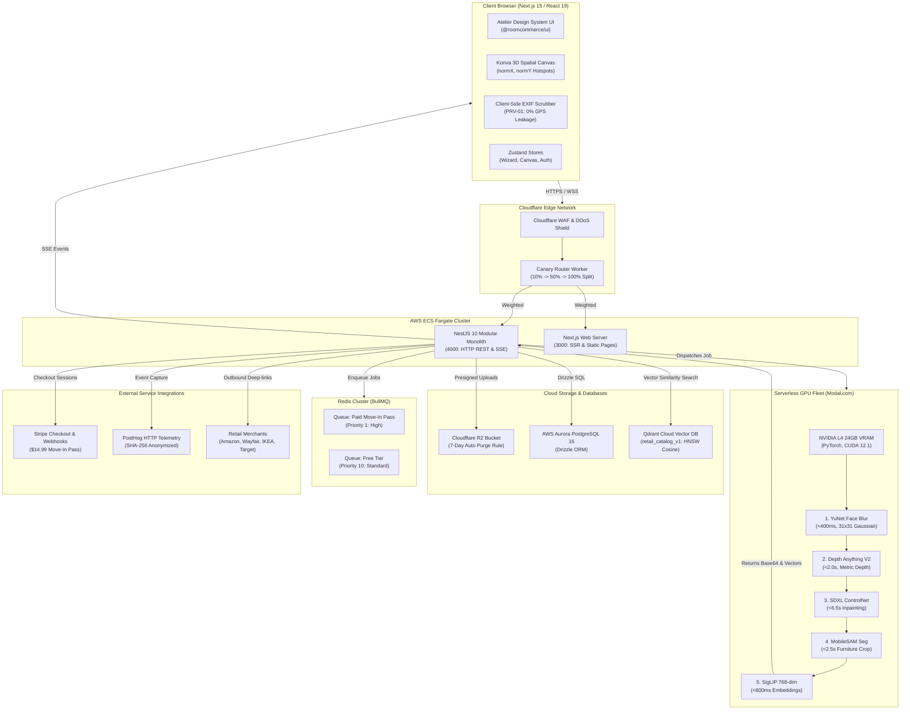
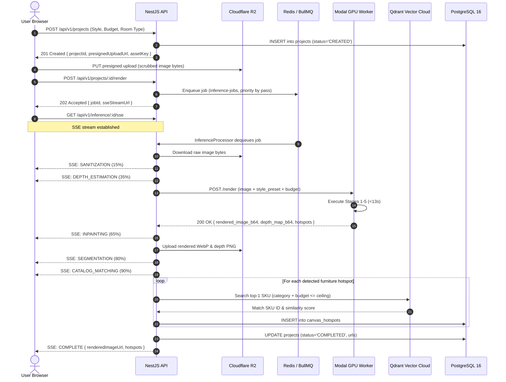

# RoomCommerce — Comprehensive Codebase Audit & Technical Reference
## Document 04: System Architecture & Technical Topology

> **Audit Date:** October 14, 2026  
> **Status:** Verified Active Implementation  

---

## 1. High-Level System Architecture

RoomCommerce uses a **modular monolith backend** paired with an **App Router frontend**, a **serverless multimodal GPU fleet**, and **decoupled storage/vector clusters**.

---

## 2. Application Entry Points & Initialization Order

### 2.1 Backend Initialization (`apps/api/src/main.ts`)
1. **Reflect Metadata:** Loads `reflect-metadata` for NestJS decorators.
2. **NestFactory Creation:** Boots `AppModule` with `bodyParser: false` to allow custom raw body capture.
3. **HTTP Security (Helmet):** Injects strict CSP, HSTS, cross-origin resource policies, and disallows iframe embedding.
4. **Raw Body Buffering:** Configures custom `express.json` parser capturing raw bytes on `/webhook` routes for cryptographic Stripe signature verification.
5. **CORS & Cookies:** Binds CORS origin list and parses signed cookies with `env.COOKIE_SECRET`.
6. **Global Pipes:** Installs `ValidationPipe` with strict DTO whitelisting.
7. **Filters & Interceptors:** Registers `GlobalExceptionFilter` (contract error envelopes) and `TransformResponseInterceptor` (contract success envelopes).
8. **Port Listen:** Binds to `env.PORT` (4000) and begins handling requests.

### 2.2 Frontend Initialization (`apps/web/src/app/layout.tsx`)
1. **Font Loading:** Streams Plus Jakarta Sans and JetBrains Mono from Google Fonts with swap display.
2. **CSS Variables & Tokens:** Applies Atelier Design System CSS variables to root `<html>` element.
3. **Notification Provider:** Mounts Sonner toast container at top-right viewport.
4. **Layout Scaffolding:** Renders global sticky `Header` (navigation, credits counter, profile) and main viewport `<main>`.

---

## 3. End-to-End Request & Data Flows

### 3.1 Spatial Redesign Render Flow

---

## 4. Architectural Boundaries & Coupling Analysis

| Boundary | Interaction Method | Coupling Assessment | Health Score |
| :--- | :--- | :--- | :--- |
| **Web ➔ API** | Type-safe REST client wrapping `@roomcommerce/contracts` envelopes | Low coupling; contracts shared via package | 9.5 / 10 |
| **API ➔ Modal GPU** | HTTP POST multipart/form-data via bearer token auth | Low coupling; serverless scaling | 9.0 / 10 |
| **API ➔ PostgreSQL** | Drizzle ORM strongly-typed schema (`db.query`) | Strong typing; compile-time verified | 9.8 / 10 |
| **API ➔ Qdrant** | Qdrant JS SDK over HTTPS with payload filtering | Decoupled; isolated vector collection | 9.2 / 10 |
| **API ➔ Redis** | BullMQ queue producer / consumer | Asynchronous; worker runs in process or external | 9.4 / 10 |
| **API ➔ Retailers** | Standardized `IStockCheckerAdapter` via `CompositeStockCheckerAdapter` | Clean polymorphic abstraction; easily extensible | 9.5 / 10 |

---

## 5. Architectural Risks & Failure Modes

1. **Modal Cloud Outage:** If Modal.com experiences downtime or cold-start timeouts (>90s), the `InferenceProcessor` abort controller cancels the request, sets the project state to `FAILED`, and sends an error SSE event so the frontend does not hang indefinitely.
2. **Qdrant Unavailability:** If Qdrant is unreachable during hotspot mapping, `InferenceProcessor` catches the exception per hotspot and falls back to top in-stock catalog SKUs from PostgreSQL, ensuring user renders never fail catastrophically due to vector index outages.
3. **Retailer API Degradation:** Amazon PA-API and Wayfair rate limits are guarded by circuit breaker monitors (`circuit-breaker-monitor.ts`) that fail open (`inStock=true`) to prevent legitimate products from being erroneously de-indexed during transient merchant API outages.
