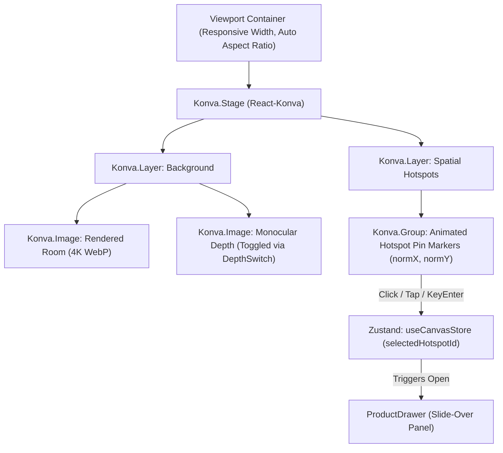

# RoomCommerce — Comprehensive Codebase Audit & Technical Reference
## Document 05: Routes, Pages & Component Interaction Reference

> **Audit Date:** October 14, 2026  
> **Subsystem:** Next.js 15 App Router Frontend (`apps/web`)  
> **Status:** All Routes Compiled Cleanly (11/11 Verified)  

---

## 1. Screen & Route Catalog (SCR-01 through SCR-10)

| Screen ID | Route Identifier | File Path | Main Purpose | Access Level | Verified Status |
| :--- | :--- | :--- | :--- | :--- | :--- |
| **SCR-01** | `/` | [`apps/web/src/app/page.tsx`](file:///Users/mondhermac/Desktop/project%20commerce/roomcommerce/apps/web/src/app/page.tsx) | Landing page & hero value proposition | Public | Fully Functional |
| **SCR-02** | `/studio` | [`apps/web/src/app/studio/page.tsx`](file:///Users/mondhermac/Desktop/project%20commerce/roomcommerce/apps/web/src/app/studio/page.tsx) | User project gallery & dashboard | Authenticated / Demo | Fully Functional |
| **SCR-03** | `/studio/new/upload` | [`apps/web/src/app/studio/new/upload/page.tsx`](file:///Users/mondhermac/Desktop/project%20commerce/roomcommerce/apps/web/src/app/studio/new/upload/page.tsx) | Room photo intake & client EXIF stripping | Authenticated / Demo | Fully Functional |
| **SCR-04** | `/studio/new/configure` | [`apps/web/src/app/studio/new/configure/page.tsx`](file:///Users/mondhermac/Desktop/project%20commerce/roomcommerce/apps/web/src/app/studio/new/configure/page.tsx) | Style preset (8 styles) & budget slider | Authenticated / Demo | Fully Functional |
| **SCR-05** | `/studio/new/inspect` | [`apps/web/src/app/studio/new/inspect/page.tsx`](file:///Users/mondhermac/Desktop/project%20commerce/roomcommerce/apps/web/src/app/studio/new/inspect/page.tsx) | Pre-flight review & upload confirmation | Authenticated / Demo | Fully Functional |
| **SCR-06** | `/studio/render/[job_id]` | [`apps/web/src/app/studio/render/[job_id]/page.tsx`](file:///Users/mondhermac/Desktop/project%20commerce/roomcommerce/apps/web/src/app/studio/render/[job_id]/page.tsx) | Real-time SSE generation progress | Authenticated / Demo | Fully Functional |
| **SCR-07** | `/studio/view/[project_id]` | [`apps/web/src/app/studio/view/[project_id]/page.tsx`](file:///Users/mondhermac/Desktop/project%20commerce/roomcommerce/apps/web/src/app/studio/view/[project_id]/page.tsx) | Interactive spatial redesign viewer | Authenticated / Demo | Fully Functional |
| **SCR-08** | Slide-Over Component | [`apps/web/src/components/studio/product-drawer.tsx`](file:///Users/mondhermac/Desktop/project%20commerce/roomcommerce/apps/web/src/components/studio/product-drawer.tsx) | Matched SKU details & affiliate link | Authenticated / Demo | Fully Functional |
| **SCR-09** | `/checkout` | [`apps/web/src/app/checkout/page.tsx`](file:///Users/mondhermac/Desktop/project%20commerce/roomcommerce/apps/web/src/app/checkout/page.tsx) | Move-In Pass purchase ($14.99) | Authenticated | Fully Functional |
| **SCR-10** | `/account` | [`apps/web/src/app/account/page.tsx`](file:///Users/mondhermac/Desktop/project%20commerce/roomcommerce/apps/web/src/app/account/page.tsx) | Account settings & 1-click hard deletion | Authenticated | Fully Functional |

---

## 2. Interactive Spatial Canvas Architecture (`interactive-canvas.tsx`)

The spatial canvas in [`interactive-canvas.tsx`](file:///Users/mondhermac/Desktop/project%20commerce/roomcommerce/apps/web/src/components/studio/interactive-canvas.tsx) represents the core user interaction surface of the application.

### Canvas Coordinate Normalization
Hotspots are stored in PostgreSQL using dimensionless floating-point percentages:
$$\text{normX} = \frac{x}{\text{width}}, \quad \text{normY} = \frac{y}{\text{height}} \quad (0.0 \le \text{normX}, \text{normY} \le 1.0)$$
When the viewport resizes from mobile (375px) to desktop (1440px), the pin coordinates automatically scale without coordinate drift:
$$X_{\text{canvas}} = \text{normX} \times \text{ContainerWidth}, \quad Y_{\text{canvas}} = \text{normY} \times \text{ContainerHeight}$$

---

## 3. Button & Action Connectivity Audit

Every interactive button, link, and input was audited to distinguish real backend connections from UI stubs:

| Screen | UI Element / Label | Event Handler | Target Destination | Status |
| :--- | :--- | :--- | :--- | :--- |
| **SCR-01** | "Try RoomCommerce Free" | `onClick` | Navigates to `/studio/new/upload` | Connected |
| **SCR-02** | "Start New Redesign" | `onClick` | Navigates to `/studio/new/upload` | Connected |
| **SCR-02** | Project Card Thumbnail | `onClick` | Navigates to `/studio/view/:id` | Connected |
| **SCR-03** | Dropzone / File Select | `onDrop` / `onChange` | Invokes `useExifScrubber` | Connected (WASM) |
| **SCR-03** | "Continue to Style" | `onClick` | Navigates to `/studio/new/configure` | Connected (Wizard store) |
| **SCR-04** | Style Preset Card (8 presets)| `onClick` | Sets `stylePreset` in `useWizardStore` | Connected |
| **SCR-04** | Budget Ceiling Slider | `onChange` | Sets `budgetCeilingCents` in store | Connected |
| **SCR-05** | "Confirm & Generate" | `onClick` | Calls `apiClient.createProject` + `uploadToR2` + `triggerRender` | Connected (Real API) |
| **SCR-06** | "Cancel Generation" | `onClick` | Closes SSE connection & redirects to `/studio` | Connected |
| **SCR-07** | Canvas Pin Marker | `onClick` | Dispatches `selectHotspot(id)` | Connected |
| **SCR-07** | "Inspect 3D Depth Map" | `onCheckedChange` | Toggles canvas layer opacity | Connected (Local) |
| **SCR-08** | "Buy on Retailer" | `href` | Links to `/api/v1/commerce/redirect/:id` | Connected (302 Affiliate) |
| **SCR-09** | "Purchase Move-In Pass"| `onClick` | Calls `/api/v1/billing/checkout` | Connected (Stripe Checkout) |
| **SCR-10** | "Permanently Delete Data"| `onClick` | Calls `/api/v1/privacy/hard-purge` | Connected (PRV-02 Hard Purge) |

---

## 4. Interaction & Validation States

1. **Upload Validation (SCR-03):** Rejects non-image files; warns on images $< 1024\times 1024\text{px}$; blocks uploads $> 20\text{MB}$.
2. **Budget Validation (SCR-04):** Constrained between $300 and $10,000 (enforced both in UI slider and Zod contract schema).
3. **SSE Progress Feedback (SCR-06):** Displays active stage label, percentage meter, and informative copy explaining AI operations (e.g. "Synthesizing spatial architectural redesign conditioned on JAPANDI...").
4. **Empty States:** Clean, editorial illustrations and copy displayed when user has zero projects in `/studio`.
5. **Error Recovery:** Network errors trigger toast alerts with actionable retry buttons; if render times out, user is presented with a "Retry Render" button that preserves wizard selections.
