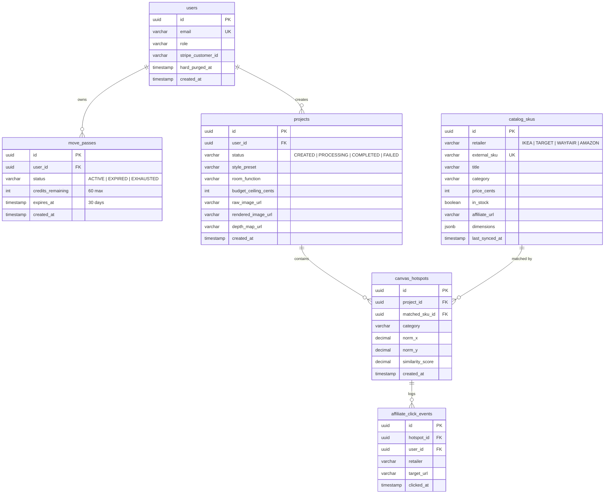

# RoomCommerce — Comprehensive Codebase Audit & Technical Reference
## Document 06: Database Schema, Vector Index & REST API Reference

> **Audit Date:** October 14, 2026  
> **Databases:** PostgreSQL 16 (Drizzle ORM) + Qdrant Managed Vector DB  
> **API Paradigm:** REST + Server-Sent Events (SSE) with Typed Zod Contracts  

---

## 1. PostgreSQL Relational Schema (`src/database/schema/`)

All relational tables are managed via **Drizzle ORM** targeting AWS Aurora PostgreSQL 16.

### Deletion & Retention Rules
* **Cascade on Project Deletion:** Deleting a `projects` row automatically cascades to all associated `canvas_hotspots` rows.
* **1-Click Hard Purge (PRV-02):** When `/api/v1/privacy/hard-purge` is called, all user projects and hotspots are deleted from PostgreSQL, raw/rendered images are purged from Cloudflare R2, and `users.hard_purged_at` is timestamped.

---

## 2. Qdrant Vector Collection (`retail_catalog_v1`)

* **Collection Name:** `retail_catalog_v1`
* **Vector Dimensions:** 768 dimensions (SigLIP-SO400M float32 embedding)
* **Distance Metric:** `Cosine`
* **HNSW Configuration:** `m = 16`, `ef_construct = 100`, full-scan on payload pre-filters.
* **Payload Indexed Fields:**
  * `in_stock` (`bool` index) — Hard pre-filter: only items with `in_stock == true` are queried.
  * `category` (`keyword` index) — Hard pre-filter: matches segmented category (e.g. `SOFA`, `COFFEE_TABLE`).
  * `price_cents` (`integer` index) — Range pre-filter: `price_cents <= project.budget_ceiling_cents`.
  * `retailer` (`keyword` index) — Optional merchant filtering.
* **Performance SLA:** Target retrieval latency $\le 80\text{ms}$ under 200 QPS (validated in `tests/load/k6-vector-search-test.js`).

---

## 3. Complete REST & SSE Endpoint Inventory

All endpoints return uniform response envelopes adhering to `@roomcommerce/contracts`:
* Success: `{ success: true, data: T, timestamp: string }`
* Error: `{ success: false, error: { code: string, message: string, details?: any }, timestamp: string }`

### 3.1 Authentication (`/api/v1/auth`)
* `POST /api/v1/auth/magic-link`: Request passwordless magic link email. (Public)
* `POST /api/v1/auth/verify`: Verify login token and receive signed JWT session cookie. (Public)
* `POST /api/v1/auth/demo-login`: Instant demo login for automated testing / sandbox evaluation. (Public)
* `POST /api/v1/auth/logout`: Clears session cookie and invalidates session. (Auth required)

### 3.2 Billing & Entitlements (`/api/v1/billing`)
* `POST /api/v1/billing/checkout`: Creates Stripe Checkout Session for the $14.99 Move-In Pass. Returns `{ checkoutUrl }`. (Auth required)
* `POST /api/v1/billing/webhook`: Ingests and processes Stripe webhook events (`checkout.session.completed`). Idempotent via event ID tracking. (Public with Stripe Sig)
* `GET /api/v1/billing/status`: Fetches active pass status, remaining credits, and expiration date. (Auth required)

### 3.3 Projects & Assets (`/api/v1/projects`)
* `POST /api/v1/projects`: Creates a new project draft. Returns `{ projectId, presignedUploadUrl, assetKey }`. (Auth required)
* `GET /api/v1/projects`: Lists user projects with pagination and preview thumbnails. (Auth required)
* `GET /api/v1/projects/:id`: Returns complete project details including rendered image URL, depth map URL, and associated canvas hotspots. (Auth required + Ownership check)
* `DELETE /api/v1/projects/:id`: Deletes project and triggers R2 asset deletion. (Auth required + Ownership check)

### 3.4 Inference & SSE Progress (`/api/v1/inference`)
* `POST /api/v1/projects/:id/render`: Dispatches BullMQ inference job (priority 1 if paid pass, priority 10 if free). Returns `{ jobId, sseStreamUrl }`. (Auth required)
* `GET /api/v1/inference/:id/sse`: Server-Sent Events (SSE) connection streaming real-time stage progress (`SANITIZATION`, `DEPTH_ESTIMATION`, `INPAINTING`, `SEGMENTATION`, `CATALOG_MATCHING`, `COMPLETE`). (Auth required)

### 3.5 Catalog & Inventory (`/api/v1/catalog`)
* `GET /api/v1/catalog/sku/:id`: Fetches detailed retail SKU specifications (title, price, dimensions, merchant badge). (Auth required)
* `POST /api/v1/catalog/sync`: Administrative trigger for catalog sync (nightly cron target). (Admin / Cron Secret required)

### 3.6 Commerce & Affiliate Redirect (`/api/v1/commerce`)
* `GET /api/v1/commerce/redirect/:hotspotId`: Resolves matched SKU, appends retailer affiliate partner ID and UTM campaign tags, records click event, and issues HTTP **302 Redirect** to merchant canonical product page. (Public / User)

### 3.7 Privacy & Hard Purge (`/api/v1/privacy`)
* `POST /api/v1/privacy/hard-purge`: Executes PRV-02 hard deletion: cascades user projects, wipes hotspots, removes R2 storage objects, and marks account purged. (Auth required)

### 3.8 Telemetry (`/api/v1/telemetry`)
* `POST /api/v1/telemetry/event`: Accepts client-side analytics events (EV-101 to EV-302), validates schema, and flushes to PostHog HTTP sink. (Auth / Public)

### 3.9 System Health (`/health` & `/api/v1/health`)
* `GET /health` & `GET /api/v1/health`: Overall health probe (HTTP 200 if healthy/degraded, 503 if down).
* `GET /api/v1/health/db`: Dedicated PostgreSQL connection check.
* `GET /api/v1/health/redis`: Dedicated BullMQ Redis ping.
* `GET /api/v1/health/qdrant`: Dedicated Qdrant Cloud health probe.

---

## 4. Third-Party Integrations Matrix

| Service | Protocol / Client | Auth Method | Failure Recovery | Production Key Source |
| :--- | :--- | :--- | :--- | :--- |
| **Stripe** | Stripe Node SDK / Webhooks | Secret API Key + Webhook Secret | Raw body signature check, idempotency | AWS SSM `/roomcommerce/prod/STRIPE_SECRET_KEY` |
| **Cloudflare R2** | AWS S3 Client (`@aws-sdk/client-s3`) | S3 Access Key ID / Secret Key | 7-day auto-purge rule, presigned PUT | AWS SSM `/roomcommerce/prod/R2_ACCESS_KEY_ID` |
| **Modal.com** | HTTP POST multipart/form-data | Bearer Token (`MODAL_API_TOKEN`) | 90s abort timeout, fallback SKU pins | AWS SSM `/roomcommerce/prod/MODAL_TOKEN_SECRET` |
| **Qdrant Cloud** | `@qdrant/js-client-rest` (HTTPS) | API Key Header | Per-hotspot catch, fallback Postgres SKUs | AWS SSM `/roomcommerce/prod/QDRANT_API_KEY` |
| **Amazon PA-API** | REST API (PA-API 5.0) | AWS Signature V4 signing | Circuit breaker fail-open (`inStock=true`) | AWS SSM `/roomcommerce/prod/AMAZON_PAAPI_SECRET_KEY` |
| **Wayfair API** | OAuth2 Client Credentials | Bearer Token (in-memory cached) | Circuit breaker fail-open on 5xx | AWS SSM `/roomcommerce/prod/WAYFAIR_API_CLIENT_SECRET` |
| **PostHog** | HTTP POST `/capture` | Project API Key | Fire-and-forget, SHA-256 IP hash | AWS SSM `/roomcommerce/prod/POSTHOG_API_KEY` |
