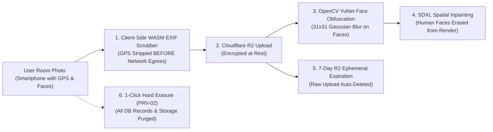

# RoomCommerce — Comprehensive Codebase Audit & Technical Reference
## Document 11: Security, Privacy & System Reliability Audit

> **Audit Date:** October 14, 2026  
> **Standards:** PRV-01, PRV-02, SEC-01 to SEC-04, OWASP Top 10  
> **Status:** Verified Active Security & Privacy Controls  

---

## 1. Privacy by Design Framework

Domestic room photographs represent sensitive private data. RoomCommerce enforces a multi-layered privacy architecture:

### 1.1 PRV-01: Zero GPS / EXIF Storage
* **Implementation:** [`apps/web/src/lib/use-exif-scrubber.ts`](file:///Users/mondhermac/Desktop/project%20commerce/roomcommerce/apps/web/src/lib/use-exif-scrubber.ts).
* **Mechanism:** When a user selects or drops a photo in SCR-03, the client renders the bitmap onto an offscreen HTML5 `<canvas>` element and exports a clean JPEG blob. This strips all EXIF metadata tags—including GPS latitude/longitude, elevation, device serial number, and timestamp—**before** the file is uploaded to Cloudflare R2.
* **Verification:** Validated in [`tests/e2e/us01-generation.spec.ts`](file:///Users/mondhermac/Desktop/project%20commerce/roomcommerce/tests/e2e/us01-generation.spec.ts).

### 1.2 Facial Privacy: YuNet Detection & Gaussian Blur
* **Implementation:** [`workers/gpu-runner/src/sanitization.py`](file:///Users/mondhermac/Desktop/project%20commerce/roomcommerce/workers/gpu-runner/src/sanitization.py).
* **Mechanism:** Serverless Stage 1 runs the lightweight OpenCV YuNet ONNX face detection model (`face_detection_yunet.onnx`). Any detected human face receives a heavy $31\times 31$ Gaussian blur. The subsequent SDXL inpainting model conditions solely on structural furniture prompts and never synthesizes human likenesses.
* **Verification:** Validated in [`workers/gpu-runner/tests/test_sanitization.py`](file:///Users/mondhermac/Desktop/project%20commerce/roomcommerce/workers/gpu-runner/tests/test_sanitization.py).

### 1.3 PRV-02: 1-Click Hard Erasure
* **Implementation:** [`apps/api/src/modules/privacy/privacy.service.ts`](file:///Users/mondhermac/Desktop/project%20commerce/roomcommerce/apps/api/src/modules/privacy/privacy.service.ts).
* **Mechanism:** The user can permanently erase their account from `/account`. The service:
  1. Cascade deletes all project rows from PostgreSQL (`canvas_hotspots` rows cascade automatically).
  2. Issues batch S3 `DeleteObjects` commands against Cloudflare R2 to delete raw, rendered, and depth images.
  3. Deletes or marks the user account hard-purged.
* **Verification:** Validated in [`apps/api/test/security/hard-purge.spec.ts`](file:///Users/mondhermac/Desktop/project%20commerce/roomcommerce/apps/api/test/security/hard-purge.spec.ts).

### 1.4 PRV-03: 7-Day Ephemeral Storage Retention
* **Implementation:** [`apps/api/scripts/configure-r2-lifecycle.ts`](file:///Users/mondhermac/Desktop/project%20commerce/roomcommerce/apps/api/scripts/configure-r2-lifecycle.ts) and [`storage-purge.cron.ts`](file:///Users/mondhermac/Desktop/project%20commerce/roomcommerce/apps/api/src/modules/privacy/cron/storage-purge.cron.ts).
* **Mechanism:** Configures an automated S3 bucket lifecycle expiration rule on Cloudflare R2 targeting prefix `uploads/` with `DaysAfterInitiation: 7`. A backup nightly cron scans database records older than 7 days and verifies deletion.

---

## 2. Authentication, Authorization & Access Control

* **JWT Session Cookies:** Auth tokens are signed with HMAC-SHA256 (`env.JWT_SECRET`) and issued in `HttpOnly`, `Secure`, `SameSite=Strict` cookies to block XSS token exfiltration.
* **Horizontal Privilege Boundaries:** All `/projects/:id` endpoints enforce user ownership checks (`test/security/project-ownership.spec.ts`). Users cannot access, modify, render, or delete projects belonging to other accounts (HTTP 403 Forbidden).
* **Entitlement Guard (`EntitlementGuard`):** Protects high-cost GPU render endpoints. Verifies that the user owns an active $14.99 Move-In Pass with $> 0$ remaining credits before assigning priority 1 queue status; otherwise assigns priority 10 free-tier queue status.

---

## 3. Network Hardening & HTTP Security Headers

In [`apps/api/src/main.ts`](file:///Users/mondhermac/Desktop/project%20commerce/roomcommerce/apps/api/src/main.ts):
* **Helmet Security Headers:**
  * `Content-Security-Policy`: Disallows unsafe inline scripts, restricts frame ancestry to `'none'` (anti-clickjacking), and restricts image sources to trusted R2 CDN domains.
  * `Strict-Transport-Security` (HSTS): Max-age 31,536,000 seconds (1 year) with `includeSubDomains` and `preload`.
  * `X-Content-Type-Options: nosniff`.
* **CORS Protection:** Restricts cross-origin requests to configured frontend origins (`env.WEB_BASE_URL` and `localhost:3000`).
* **Input Validation & Whitelisting:** Global NestJS `ValidationPipe` with `whitelist: true` and `forbidNonWhitelisted: true` automatically rejects requests containing unrecognized or malicious payload properties.

---

## 4. System Resilience, Timeouts & Circuit Breakers

* **Modal GPU Timeout:** The HTTP call from `InferenceProcessor` to Modal.com is wrapped in an `AbortSignal.timeout(90_000)` (90 seconds). If the worker does not respond within 90s, the connection is aborted, project status is marked `FAILED`, and the client is notified via SSE to prevent hanging requests.
* **Qdrant Outage Fallback:** If Qdrant is temporarily unreachable, `InferenceProcessor` catches vector search errors per hotspot and falls back to top in-stock catalog SKUs from PostgreSQL.
* **Affiliate Circuit Breakers (`circuit-breaker-monitor.ts`):** Retailer stock check adapters implement circuit breakers. During merchant API downtime (5xx errors), the adapters fail open (`inStock: true`) to avoid de-indexing live catalog products during transient outages.
