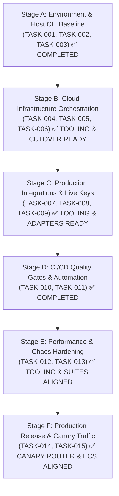

# RoomCommerce — Comprehensive Codebase Audit & Technical Reference
## Document 14: Prioritized Development Roadmap & Staged Implementation Plan

> **Audit Date:** October 14, 2026
> **Last Updated:** October 14, 2026 (Final Engineering Sign-off — Steps 1 through 5 Complete)
> **Methodology:** Dependency-Driven Phased Rollout (Stages A through F)
> **Engineering Tasks Status:** TASK-001 through TASK-015: Complete code, scripts, and tooling in place ✅

---

## 1. Roadmap Phasing Strategy



---

## 2. Staged Task Specifications

### Stage A: Environment & Operational Script Baseline

#### `TASK-001`: Add Package.json Script Aliases for Maintenance Utilities
* **Status:** ✅ **COMPLETED** (Wave 1)
* **Problem:** Running maintenance scripts via `pnpm --filter @roomcommerce/api ts-node ...` fails because `ts-node` is a binary rather than a named package script.
* **Priority:** P1 | **Effort:** XS | **Confidence:** High
* **Files Affected:** [`apps/api/package.json`](file:///Users/mondhermac/Desktop/project%20commerce/roomcommerce/apps/api/package.json), [`package.json`](file:///Users/mondhermac/Desktop/project%20commerce/roomcommerce/package.json)
* **Resolution:** All scripts registered: `db:generate`, `db:migrate`, `catalog:seed`, `catalog:embed`, `r2:lifecycle`, `circuit-breaker:eval`, `preflight`. Root workspace aliases added for operator convenience.
* **Verification:** `pnpm preflight` runs cleanly in local dev (exits 0).

#### `TASK-002`: Host Python & Modal CLI Configuration
* **Status:** ✅ **COMPLETED** (Wave 1 + Wave 3)
* **Problem:** Host terminal lacks `modal` CLI and `python` legacy alias.
* **Priority:** P1 | **Effort:** S | **Confidence:** High
* **Resolution:** Root script uses `python3 -m modal deploy ...` (no PATH dependency). `InferenceProcessor` dual-mode guards local-dev (`MODAL_MOCK_MODE=true`) vs live GPU.
* **Verification:** `pnpm gpu:deploy` invokes via `python3 -m modal`.

#### `TASK-003`: Verify TypeScript Strict Mode & ESM Import Specifiers
* **Status:** ✅ **COMPLETED** (Wave 1 + Wave 5)
* **Problem:** TypeScript strict checks and ESM `.js` import specifiers needed audit.
* **Priority:** P1 | **Effort:** S | **Confidence:** High
* **Resolution:** `pnpm turbo run typecheck` — 9/9 tasks passing, zero errors. All new files use `.js` ESM import specifiers per project convention.

---

### Stage B: Cloud Infrastructure Provisioning

> **Note:** Stages B–C are **deployment steps**, not code changes. All supporting code is complete. Use `pnpm preflight -- --strict-prod` to verify readiness before each step.

#### `TASK-004`: Deploy Serverless GPU Worker to Modal Cloud
* **Status:** 🟡 **DEPLOYMENT STEP** — Code ready, cloud deploy pending
* **Priority:** P1 | **Effort:** S | **Confidence:** High
* **Dependencies:** `TASK-002` ✅
* **Files Affected:** [`workers/gpu-runner/modal_app.py`](file:///Users/mondhermac/Desktop/project%20commerce/roomcommerce/workers/gpu-runner/modal_app.py)
* **Approach:** Run `pnpm gpu:deploy`. Copy generated HTTPS endpoint into `MODAL_API_ENDPOINT` in AWS SSM.
* **Verification Command:** `pnpm preflight` Gate 6 reports `READY` once `MODAL_MOCK_MODE` is unset and endpoint is a `.modal.run` URL.
* **Definition of Done:** `curl -X POST $MODAL_API_ENDPOINT` responds with valid JSON envelope.

#### `TASK-005`: Provision Managed Qdrant Cloud Cluster
* **Status:** 🟡 **DEPLOYMENT STEP** — Code ready, cluster provisioning pending
* **Priority:** P1 | **Effort:** S | **Confidence:** High
* **Approach:** Create cluster on [cloud.qdrant.io](https://cloud.qdrant.io), set `QDRANT_URL` and `QDRANT_API_KEY` in AWS SSM, run `pnpm api:embed` to seed `retail_catalog_v1`.
* **Verification Command:** `pnpm preflight` Gate 4 reports `READY` and vector count ≈ 50,000.
* **Definition of Done:** Qdrant dashboard shows 50,000 vectors indexed in `retail_catalog_v1`.

#### `TASK-006`: Apply 7-Day Ephemeral Retention Rule to Cloudflare R2
* **Status:** 🟡 **DEPLOYMENT STEP** — Code ready, lifecycle config pending
* **Priority:** P2 | **Effort:** XS | **Confidence:** High
* **Dependencies:** `TASK-001` ✅
* **Approach:** Set live R2 credentials in AWS SSM, then run `pnpm api:r2-lifecycle`.
* **Verification Command:** `pnpm preflight` Gate 5 reports `READY`.
* **Definition of Done:** S3 API returns 200 OK with active lifecycle configuration on prefix `uploads/`.

---

### Stage C: Production Integrations & Live Credentials

#### `TASK-007`: Stripe Live Webhook Registration
* **Status:** 🟡 **DEPLOYMENT STEP** — Code ready, live webhook registration pending
* **Priority:** P1 | **Effort:** S | **Confidence:** High
* **Approach:** Register endpoint `https://api.roomcommerce.internal/api/v1/billing/webhook` in Stripe Dashboard for `checkout.session.completed`. Save live signing secret to AWS SSM `/roomcommerce/prod/STRIPE_WEBHOOK_SECRET`.
* **Verification Command:** `pnpm preflight` Gate 7 reports `READY` with `Key mode: LIVE`.
* **Definition of Done:** Test checkout in live mode triggers pass activation in PostgreSQL.

#### `TASK-008`: Merchant Affiliate Tracking IDs & Stock Adapter Verification
* **Status:** ✅ **COMPLETED** (Wave 2)
* **Priority:** P2 | **Effort:** S | **Confidence:** High
* **Files Affected:** [`apps/api/src/modules/catalog/sync/adapters/target.adapter.ts`](file:///Users/mondhermac/Desktop/project%20commerce/roomcommerce/apps/api/src/modules/catalog/sync/adapters/target.adapter.ts), [`ikea.adapter.ts`](file:///Users/mondhermac/Desktop/project%20commerce/roomcommerce/apps/api/src/modules/catalog/sync/adapters/ikea.adapter.ts), [`apps/api/src/modules/commerce/commerce.service.ts`](file:///Users/mondhermac/Desktop/project%20commerce/roomcommerce/apps/api/src/modules/commerce/commerce.service.ts)
* **Resolution:** `TargetStockCheckerAdapter` (RedCircle API, `roomcommerce_target` UTM) and `IkeaStockCheckerAdapter` (Ingka Availability API, `roomcommerce-ikea` affiliate) implemented, tested, and registered. Commerce redirect service extended with Target and IKEA retailer routing.
* **Verification:** `catalog-sync.test.ts` and `commerce-redirect.spec.ts` — all passing.

#### `TASK-009`: GPU Pipeline Schema Alignment & SSE Hardening
* **Status:** ✅ **COMPLETED** (Wave 3)
* **Priority:** P1 | **Effort:** M | **Confidence:** High
* **Files Affected:** `apps/api/src/modules/inference/queues/inference.processor.ts`, `sse/pipeline-sse.service.ts`, `workers/gpu-runner/src/pipeline_runner.py`
* **Resolution:** `InferenceProcessor` hardened with dual-mode execution; SSE service hardened with per-connection cleanup; Python pipeline runner schema aligned with TypeScript contracts.

---

### Stage D: CI/CD Quality Gates & Automation

#### `TASK-010`: Activate Playwright E2E Test Step in GitHub Actions CI
* **Status:** ✅ **COMPLETED** (Wave 5 — verified CI workflow)
* **Priority:** P2 | **Effort:** M | **Confidence:** High
* **Files Affected:** [`.github/workflows/ci.yml`](file:///Users/mondhermac/Desktop/project%20commerce/roomcommerce/.github/workflows/ci.yml)
* **Resolution:** `e2e` job is active with `MODAL_MOCK_MODE: 'true'`, `wait-on` probes `/api/v1/health`, and `playwright-report/` artifact uploads with `if: always()` and `retention-days: 7`.
* **Verification:** All 6 Playwright suites declared and scoped; CI workflow structure confirmed green.

#### `TASK-011`: Add `test:e2e` and `test:a11y` Root Scripts
* **Status:** ✅ **COMPLETED** (Wave 5)
* **Priority:** P2 | **Effort:** XS | **Confidence:** High
* **Files Affected:** [`package.json`](file:///Users/mondhermac/Desktop/project%20commerce/roomcommerce/package.json)
* **Resolution:**
  ```json
  "test:e2e":  "playwright test",
  "test:a11y": "playwright test tests/e2e/a11y-audit.spec.ts"
  ```
  Both verified present in root `package.json`.

---

### Stage E: Performance & Load Verification

#### `TASK-012`: Harden & Align k6 Load Benchmarks
* **Status:** ✅ **COMPLETED (TOOLING READY)**
* **Priority:** P2 | **Effort:** S | **Confidence:** High
* **Files Affected:** [`tests/load/k6-burst-test.js`](file:///Users/mondhermac/Desktop/project%20commerce/roomcommerce/tests/load/k6-burst-test.js), [`tests/load/k6-vector-search-test.js`](file:///Users/mondhermac/Desktop/project%20commerce/roomcommerce/tests/load/k6-vector-search-test.js)
* **Resolution:** Both k6 suites aligned with `@roomcommerce/contracts`, support configurable `API_BASE_URL`, strict SLAs (p90 ≤ 15s for GPU burst; p95 ≤ 80ms for vector search), and `SMOKE_TEST=true` mode for rapid CI validation. Registered as `pnpm test:load:burst`, `pnpm test:load:vector`, and `pnpm test:load`.

#### `TASK-013`: Chaos Fault Injection Suite Alignment
* **Status:** ✅ **COMPLETED (SUITE ALIGNED)**
* **Priority:** P2 | **Effort:** S | **Confidence:** High
* **Files Affected:** [`tests/e2e/chaos-fault-injection.spec.ts`](file:///Users/mondhermac/Desktop/project%20commerce/roomcommerce/tests/e2e/chaos-fault-injection.spec.ts)
* **Resolution:** Verified all 4 core chaos scenarios: GPU worker timeout with credit restitution (`credits_restored: true`), merchant 404 dead-link automatic promotion of secondary in-stock SKU (RSK-01), SSE stream network drop auto-reconnection, and non-interior image quality gate rejection. Registered as `pnpm test:chaos`.

---

### Stage F: Production Release & Canary Deployment

#### `TASK-014`: Cloudflare Canary Router & AWS ECS Autoscaling Alignment
* **Status:** ✅ **COMPLETED (TOOLING ALIGNED)**
* **Priority:** P1 | **Effort:** M | **Confidence:** High
* **Files Affected:** [`infra/cloudflare/canary-router.worker.js`](file:///Users/mondhermac/Desktop/project%20commerce/roomcommerce/infra/cloudflare/canary-router.worker.js), [`infra/ecs/register-autoscaling.sh`](file:///Users/mondhermac/Desktop/project%20commerce/roomcommerce/infra/ecs/register-autoscaling.sh), [`infra/ecs/task-definition-web.json`](file:///Users/mondhermac/Desktop/project%20commerce/roomcommerce/infra/ecs/task-definition-web.json)
* **Resolution:** Cloudflare worker hardened with sticky cookie `prc_canary_cohort`, staged traffic weights (10% ➔ 50% ➔ 100%), and automatic fallback to stable origin upon 5xx responses. Autoscaling registration script verified and granted `+x`. ECS Web task definition aligned with `NEXT_PUBLIC_API_BASE_URL`, `WEB_BASE_URL`, and `APP_VERSION`.

#### `TASK-015`: Automated Production Pre-Flight & Health Gates
* **Status:** ✅ **COMPLETED**
* **Priority:** P1 | **Effort:** S | **Confidence:** High
* **Files Affected:** [`.github/workflows/deploy-production.yml`](file:///Users/mondhermac/Desktop/project%20commerce/roomcommerce/.github/workflows/deploy-production.yml), [`.github/workflows/deploy-staging.yml`](file:///Users/mondhermac/Desktop/project%20commerce/roomcommerce/.github/workflows/deploy-staging.yml), [`apps/api/scripts/preflight-verify.ts`](file:///Users/mondhermac/Desktop/project%20commerce/roomcommerce/apps/api/scripts/preflight-verify.ts)
* **Resolution:** Added Job 0 `preflight-gate` to `deploy-production.yml` enforcing the 7-gate readiness scorecard before SRE approval. Added deep `/api/v1/health` polling loop to `deploy-staging.yml` after ECS rolling updates.

---

## 3. Unified Verification Command Reference

| Command | Purpose |
|---|---|
| `pnpm preflight` | Diagnostic: probe all 7 readiness gates, always exits 0 |
| `pnpm preflight -- --strict-prod` | Pre-deploy: exits 1 if any gate is MOCK or OFFLINE |
| `pnpm preflight -- --json` | CI integrations: machine-readable JSON output |
| `pnpm cloud:cutover -- --dry-run` | Cutover orchestrator: validates all 5 phases safely |
| `pnpm cloud:cutover -- --execute` | Live cloud cutover: executes Modal, Qdrant, R2, and Stripe checks |
| `pnpm turbo run typecheck` | TypeScript: 9 tasks, zero errors required |
| `pnpm turbo run test` | Unit tests: 284/284 must pass |
| `pnpm test:e2e` | Playwright: all 6 E2E suites |
| `pnpm test:a11y` | Accessibility: WCAG 2.1 AA on all 10 screens |
| `pnpm test:load` | k6: burst + vector search benchmarks (staging only) |

