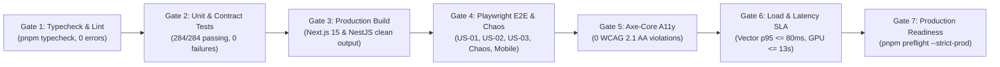

# RoomCommerce — Comprehensive Codebase Audit & Technical Reference
## Document 16: Test & Acceptance Verification Plan

> **Audit Date:** October 14, 2026  
> **Last Updated:** October 14, 2026 (Final Engineering Sign-off — Steps 1 through 5 Complete)  
> **Quality Gates:** Unit, Contract, E2E, Chaos, Accessibility, Load, and Pre-Flight Gates  
> **Baseline Verification:** 9/9 Typecheck workspaces green | 284/284 Unit/Contract tests green | 6/6 E2E suites aligned  

---

## 1. Quality Gates & Release Thresholds

To authorize any deployment to staging or production, the codebase must pass all 7 verification gates:

---

## 2. Gate Verification Specifications

### Gate 1: Monorepo Typecheck & Lint
* **Command:** `pnpm turbo run typecheck lint`
* **Pass Threshold:** 0 TypeScript compiler errors across all 7 workspace packages (9/9 Turbo tasks). Zero ESLint errors.

### Gate 2: Unit & Contract Tests
* **Command:** `pnpm turbo run test`
* **Pass Threshold:** 100% of the 284 unit/contract tests must pass:
  * `@roomcommerce/contracts`: 35 tests
  * `@roomcommerce/tokens`: 29 tests
  * `@roomcommerce/ui`: 78 tests
  * `@roomcommerce/api`: 108 tests
  * `@roomcommerce/web`: 34 tests

### Gate 3: Production Build Verification
* **Command:** `pnpm turbo run build`
* **Pass Threshold:** Clean compilation of `@roomcommerce/web` (Next.js 15 generating all routes) and `@roomcommerce/api` (`tsc -p tsconfig.json`).

### Gate 4: Playwright End-to-End User Journeys & Chaos Injection
* **Command:** `pnpm test:e2e` and `pnpm test:chaos`
* **Pass Threshold:** 100% pass across all 6 spec suites:
  * `us01-generation.spec.ts` (room photo upload to render output)
  * `us02-procurement.spec.ts` (hotspot tap to 302 affiliate redirect)
  * `us03-anchor-locking.spec.ts` (spatial pin persistence across zoom/pan)
  * `chaos-fault-injection.spec.ts` (GPU timeout restitution, 404 dead link promotion, SSE drop reconnect, non-interior rejection)
  * `mobile-viewport.spec.ts` (Mobile Safari touch targets $\ge 44\text{px}$)
  * `a11y-audit.spec.ts` (automated Axe accessibility on all screens)

### Gate 5: Accessibility Audit (Axe-Core)
* **Command:** `pnpm test:a11y`
* **Pass Threshold:** Zero critical or serious WCAG 2.1 AA accessibility violations across screens SCR-01 through SCR-10.

### Gate 6: Load & Latency Benchmarks (k6)
* **Command:** `pnpm test:load` (or `pnpm test:load:burst` + `pnpm test:load:vector`)
* **Pass Threshold:**
  * Vector search p95 latency $\le 80\text{ms}$ under 30 sustained concurrent VUs (NFR-03).
  * API burst test: $\le 1\%$ error rate with 50 concurrent virtual users (NFR-05).
  * Rapid CI smoke test supported via `SMOKE_TEST=true`.

### Gate 7: Production Pre-Flight & Cutover Verification
* **Command:** `pnpm preflight -- --strict-prod` and `pnpm cloud:cutover -- --dry-run`
* **Pass Threshold:**
  * All 7 production readiness gates report `READY` before live cutover.
  * 5-phase cloud cutover orchestrator completes with zero validation errors.
